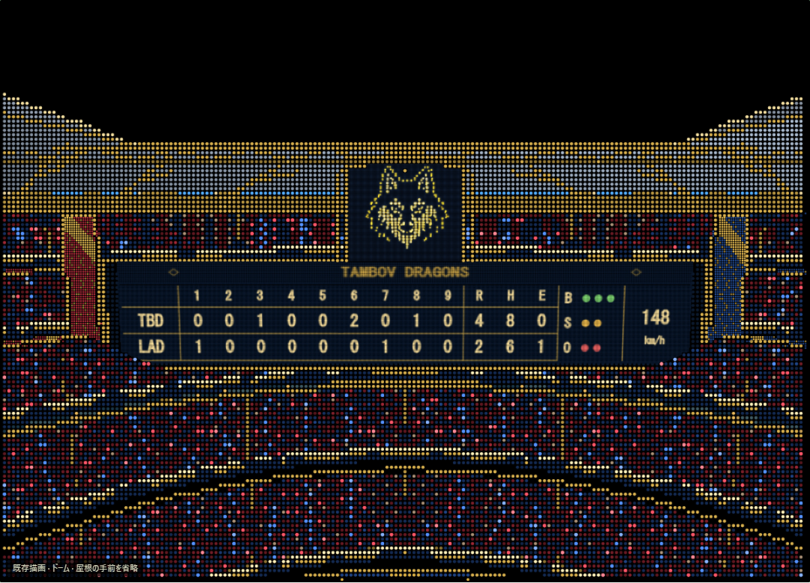

# 球場制作部

2026-10-25公開。タンボフドラゴンズ球場の制作で確立した技術、実装、素材、制作過程を引き継ぐための入口。

**球場設計室のデザインは本人が完成確認済み。芝生ロゴの明るさは0.8倍を採用。通常試合への新球場の物理・公式判定・スコア接続は未実装。** この部門の実装済み範囲を `DESIGN_ACCEPTED_NOT_MATCH_CORE_ADMITTED` と呼ぶ。



画像は完成確認前段のscoreboard-a5の実描画記録。0.8倍を採用した最新HTMLは下記の同梱成果物。画像生成による承認イメージと、実装のスクリーンショットは区別する。

| 目的 | 入口 |
|---|---|
| 技術の全体像・実装の対応 | [技術解説](METHODS.md) |
| 別の球場を作る・改善を続ける | [制作手順](WORKFLOW.md) / [詳細作業指針](../docs/ballpark-studio/STADIUM-AUTHORING.md) |
| このPCに依存せず検証・再制作 | [再現コマンド](REPRODUCTION.md) |
| 素材の由来・検証・過去の不採用案 | [素材と証拠の扱い](ASSETS-EVIDENCE.md) |
| 採用値と完成確認 | [採用記録](../docs/ballpark-studio/CURRENT-accepted.md) |
| 個別の実装・制作履歴 | [ロゴ](../docs/ballpark-studio/README-v3.md)、[建築](../docs/ballpark-studio/README-architecture.md)、[観客](../docs/ballpark-studio/README-crowd-tiles.md)、[表示盤](../docs/ballpark-studio/README-scoreboard.md) |
| 実装ソース・テスト・素材 | [tools/ballpark-studio](../tools/ballpark-studio) |
| 引継ぎ状態と公開判断 | [今回の公開記録](PUBLICATION.md) |

## 採用された球場

赤・青・金、ロシアをモチーフにした開閉式ドーム。12万人は設計上の収容人数であり、12万個の観客actorを生成する意味ではない。右翼105m・中堅128m、5層の観客席、低いフェンス、内野席、狼の芝生ロゴ・壁面ロゴ、中央スコアボード。左翼105mと壁高1.3mは編集可能な暫定値。内野の塁・本塁・線の幾何は固定し、球場差で動かさない。

現在の確認視点は9つ：球場全景、外観、スタンドから、スコアボード、真上、捕手、投手、打者、野手。建築・素材は同じ世界座標を使い、視点別の別絵でごまかさない。

## すぐ使う

```sh
node ballpark-production/production.mjs verify
node ballpark-production/production.mjs test
node ballpark-production/production.mjs extract
```

`extract` は完成HTMLを `ballpark-production/dist/球場設計室_v3_局所密度版.html` に復元する。ブラウザで開く。Node.js 20以降を想定し、今回の実行環境は24.19.0。元の制作PCや追加のゲームファイルは不要。ソースからのbuildだけは固定版esbuildのインストールが必要。

この制作法を唯一の正解に固定しない。本人の見た目・固定内野・編集の可逆性・試合Coreとの境界を守り、実測と比較画像が改善を示す場合は方法を更新してよい。
