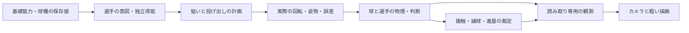

# 現仕様と責任分担

v79で [63コース・シーズン成績・方向配分](course-season-v79.md) を追加。公開9はzone内のみ、ボールゾーンは別枠。先天/今季/練習/公開H/AB/長期を分離し、通常HTMLとメーカーの版付きJSONで保存する。v78の球種・空力・独立得能・カメラは継承する。最終検証は [v79索引](../verification/releases/v79/README.md) で、公開保存状況は再開入口で確認する。

記録対象：通常HTMLのHostと共有物理・守備走塁・裁定、選手メーカー、打撃比較、投手調整室。v78は通常HTML・メーカー・調整室の限定検証を完了。製品`8b4bc90905dc5708f3181959dd8657552e344b75`をGitHubへ保存し、PUBLICATION 2e0f0832で照合済み。公開済み成果物と検証結果は[最新入口](../handoffs/LATEST.md)で区別する。

## 世界を中継するゲーム

ゲーム内ではSI単位の球・選手・ベース・球場が先に動く。カメラはその観測結果を4pxの粗い描画で中継する。画面の都合で球の位置・アウト・得点・捕球を作らない。標準の表示間隔55msと、自由な投球ボールの22ms表示は物理の刻みではない。

画面は名前の重なり・サイズ、保持球の非表示、遠近サイズ等を変更できるが、物理Sourceと裁定の所有者ではない。投手・打者・捕手・走者・守備・俯瞰のカメラは同じ球を観測する。

## 能力・得能・リーグ比較

基礎値は速度m/s、秒、メートル、角度rad、回転rad/s等で保存する。主な公開能力の編集は関連する基礎設定へ写す。メーカーでは100超も扱える項目があるが、試合の公開表示は100まで。選球眼は絶対値1〜100で、比較リーグの平均に合わせて変動しない。リーグ比較は選手作成の参考表示。

独立得能は`live_trait_profile_v2`へ保存し、実行入口で一回だけ合成する。付与・段階・倍率で公開能力・詳細基礎値を書き換えない。同系統の金と通常段階を重複適用しない。通常試合で動く17系統だけを人間用編集へ表示する。未接続のペナント・育成・故障管理等を、名前だけの有効スイッチにしない。

旧v1 JSONは読み込みだけで変換しない。旧送球は変更前の基礎値が残っていないため現在SIを保持する。独立得能の推定付与をしない。旧緑特の明示移行は保存baselineを使う。詳しくは[v77報告](../reports/2026-10-20-v77-independent-traits-and-pitcher-lab.md)。

## 球種・投球の再現性

v78は15基本分類、日本の別名・握り・方向の派生、名前付きオリジナル球を分ける。分類名がそのまま固有の力を意味するわけではない。球速、回転vector、材質姿勢、空力設定が実際の軌道を決める。

選手の各球には分類とは別の`pitchId`があり、異なるスライダーを複数持てる。レパートリーを明示した選手のAUTOは所持球だけから選ぶ。旧設定の7球種・AUTO・旧fork等のaliasは互換経路に残す。

投手詳細の最低回転維持率80%なら、基準1000rpmから800〜1000rpmへ毎投球下振れする。98%なら980〜1000rpm。旧省略・100%は固定。独立したseed付き乱数列を使用し、同seed同入力は同じ結果になる。回転軸とジャイロ比はこの設定で変えない。「制球」はコース誤差であり、この再現性とは別。

名目回転で投げる方向を計画した後、実回転の下振れを自由球の初期Sourceへ反映する。同じ投球の失敗を投手が先読みして補償しない。試投は通常試合と同じLivePitchを使用し、試投用の別物理を作らない。

## 特殊空力と姿勢

重力、相対空気速度による抗力、Magnus、回転減衰、地面の反発・摩擦・転がりを扱う。v78は既存の縫い目曲線と材質姿勢から滑らかな横力を求める版付き近似モデルを追加する。低回転時の向き依存の変化と、高回転時の縫い目効果を回転数の閾値だけで消さない。

従来のSource起点の相対回転と、実球の材質姿勢を区別する。RK4の各段階の力と姿勢を整合させ、衝突・バウンド・捕球・送球でも位相を引き継ぐ。横力は相対空気速度と直交し、係数には上限がある。高回転では姿勢が一段階で飛び過ぎないよう積分刻みを細分する。持球中は自由球の空力を作用させない。

研究の力係数オーダーを参考にしているが、3D写像の幅・ゲイン等は作者近似で、個々の実球への実測校正やCFDではない。[モデル・根拠・検証範囲](../research/2026-10-20-seam-force-v78.md)。無回転でも縫い目横力は残り得るため、無回転比較を「すべての横力がない球」とは扱わない。

## 俯瞰サイズの意味

v78の「高さの遠近感」は、地面からの高度だけをサイズ計算時に倍率倍とする。2mの打球を設定2で描くと、同じx/zで4mの球を設定1で描いた投影サイズになる。直径を一律2倍にする機能ではない。

画面中心位置と影は実座標。接地時の小さな白点を基準に仮想高度の投影比を使う。対象は俯瞰の自由な打球だけで、投球・送球・他視点・保持球非表示・物理はこの設定で変わらない。仮想球がカメラに達する場合は表示サイズのみ上限を設ける。旧直径倍率と新高度倍率は保存のモデル識別子で分ける。

## 保管・編集・試合への反映

オリジナル球はメーカー内の閉じられる保管タブへ、安定IDと版履歴で保存する。他選手への付与は選んだ版の物理設定のコピー。保管庫の後日の編集が既適用選手へ波及しない。JSONが移動・バックアップの正本で、端末保存・復元は明示操作。

人間向け画面とAI用JSONは同じvalidatorとデータを使う。モード切替は選手や試合を変更しない。不正な値は原子的に拒否する。最高球速を超える球を付与するために基礎能力を自動変更しない。

投手調整室は編集後すぐ試投できる。通常HTMLへの選手JSON反映は新しい試合から行い、進行中の球・履歴を書き換えない。バット比較と投手試投は、通常ゲームのrendererを観測用iframeとして共有する。

## 守備・走塁・残る境界

通常試合では汎用の役割分担、捕球・送球・中継・持球での踏塁、走者の判断とベース旋回、物理的な接触と裁定を接続している。場面を名指ししたゲッツーパッチやアウト率の直接指定は方針外。能力・判断時間・安全余裕・積極性等で個性を調整する。

通常HTMLでの接続を、正式Nativeの認証付き連続世界・全ルール・現実の成績分布の完成と同一視しない。未完の項目は元の全計画とCURRENTに保持する。100試合分布の校正、実機スマホ、残る心理・疲労・故障・牽制・盗塁・身体ブロック・こぼれ球等は、それぞれの実装と検証の証拠が必要。
