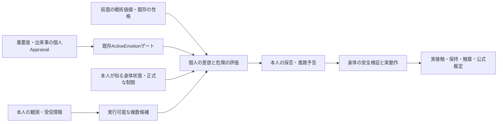

# 複数追球・連続ダイビングと個人の守備意欲

2026-10-25 JST。状態: **提案・計画作成のみ。製品実装は未着手**。
Task `MB-20261025-PURSUIT-EMOTION-PLAN`。

## 1. 目的と既存の事実

一人が追球しただけで周囲が一斉にカバーへ移るような機械的判断を減らす。二人以上が別の時刻・位置から捕球を試み、先行者が失敗した後の捕球、双方失敗からの回収、前後に分かれた連続diveを、各人の判断と実身体から成立させる。成功・失敗・担当数はシステムで固定しない。

既存の [現行V118監査](../../verification/defense-multiple-approach-2026-10-25/FINDINGS.md) では、一塁手のdive→再起→本人触塁OUT、二遊間の通常追球で先行者失敗/後続者保持/双方失敗が成立した。ただし近い二遊間のdive候補は、味方の最大速さ×再起までの全時間という到達可能円による安全guardが抑制する。carry予測が再起完了より早い到達を出す注意点も残る。

`LiveFieldDecisionV1.ts` の「他人が早いほど追球costが大きい」「cover候補の固定benefit」「味方の追球宣言を受けたときの競合評価」を、役割の一斉移動を生み得る組合せとして対象化する。全員が必ずカバーする禁止命令が存在すると断定するものではない。

## 2. 採る方式と代案

推奨は、**個人の追球候補を増やし、時刻を持つ前後の進路を調整し、最後に実身体の安全制約を検証する方式**。

代案として「最大二人まで」「二番目は自動カバー」「近い二人は常にdive」を考えたが、人数・positionで結果を固定し、同じ不自然さが残るため採らない。大規模な新しいチーム司令塔/AIエンジンへの置換も、V118の個人認識と採否を失うため採らない。

実装順は、心理がなくても自然に連携できる第一段階と、既存の心理を接続する第二段階に分ける。感情で基礎判断の欠陥を隠さない。

## 3. 複数人が関われる候補比較

各人は自分が観測した球、味方の位置/速度と受信済みの意図から、直接捕球、少し後ろで次の球を捕る、弾いた球への追従、跳ねた後の捕球、dive/jump、塁カバー、中継、待機を比較する。

- 他人の「捕る」という宣言は成功の保証にしない。より早い味方がいるだけで本人の追球を消さない。
- 本人が追加で関与する価値を、別の捕球窓、先行者の届き方の不確実性、後逸/弾いた場合の回収、他所を空ける損失から評価する。先行者が実際に失敗する未来は参照しない。
- 同じ点へ重なるより、手前/奥・少し横の実行可能な捕球窓を選べるようにする。二塁手が手前/遊撃手が奥とpositionで固定せず、実際の位置・向き・能力・本人の採否で変える。
- 同じ塁のカバーへ全員が向かう価値は、本人が知る他者の到着/引受けと照らして減る。中央で「カバー担当は一人」と命令する方式にはしない。
- 遠い選手や間に合わない選手まで一律に追球させない。役に立つ回収・カバー・待機にも根拠を持たせる。
- 先行者の接触失敗は、本人が見た/聞いた時点以降に再判断する。球を後続のグラブへ移す、実保持を手前の選手から直接引き継ぐ処理を作らない。

## 4. 前後の安全と連続した動作

追球の予告には発行/受信/採否/失効の時刻、改訂、予定区間を持たせる。予約は本人の採用した動作にだけ結び付ける。未受信の他人の私的予定を、戦術評価へ渡さない。

安全の実行層は、実行が確定した身体/手足の軌道、飛び込みの伸び、着地、滑走、再起、停止可能距離を連続時間で照合する。ここでは真の実行状態を使えるが、その詳細を本人の戦術入力へ逆流させない。安全判定は危険な動作を拒否/再提案するだけで、追球役・捕球成功・OUTを決めない。

個人の意図採用、進路の予告、物理commandの実commitを区別する。safe証拠は検証した全commandのID/revision・身体開始状態・world revision・開始tick・有効区間に束縛する。共同の新commandは同tickのcommit時点で原子的に再検証し、一人の改訂/辞退で古い証拠を使わせない。airborne等で既に実commitした曲線は通常の意図撤回では消さず、後続commandの不可侵の安全境界として扱う。

二人が安全な前後/横の経路を本人の判断で採用した場合に、それぞれがdiveできる。相手の先の進路が未確定/不明な区間は安全と偽装せず、通常追球や別の捕球窓を選ぶ。拒否後に全員停止/永久待機/ゼロ時刻反復にしない。airborneになった動作を中空で打ち切らず、球を誰かが捕った後も、その選手が情報を得て減速・着地・再起する。

**離隔係数の一律縮小、身体の重なり許容、捕球半径拡大、上限を超える加速、感情による安全guard解除はしない。**

一塁手の自力触塁、投手等へのfeed、中継の次の送球、走者側の判断で、実行中動作の回復完了と回復後位置/速度から到達を見積もる。回復・反応・持ち替え・旋回の並行/直列関係を一箇所で定義し、同じ待ち時間を二重加算しない。世界の接触eventやプレー終了の時刻へ個人の推定を使わない。

## 5. 戦術・性格・感情・身体状態を分ける

提案する判断の流れ:

能力は「できる範囲」、意欲は「その範囲でどこまで挑むか」とする。公開能力/絶対SI/緑得能を書き換えない。既存 `fielding_aggression` はLiveへ接続済みであり、新しい意欲層で同じ得能を再度掛けない。

能力を見せるための比較集団/公開ランクと、実際の大会順位を分ける。公開能力の比較集団を切り替えただけで、自信・意欲・身体性能・守備判断を変えない。

### 5.1 平常の戦術判断

試合中に本人が知る点差、回、アウト、走者、残る機会から、失点を防ぐ価値と失敗後の追加進塁を比較する。怪我を避けたい場面でも通常の守備機会を一斉放棄せず、安全な捕球/後の回収を選べるようにする。「N点差なら捨て試合」というグローバルflagは使わない。

新しい任意の `LiveDefensiveTacticalContextV1` を、Hostのfield play開始前のcanonical match snapshotから共通mapperへ渡す。source snapshot/tick、score/inning/half/outsとruleの既知情報を持たせる。Live adapterがモデルversion付きで戦術価値と `Appraisal.event.localLeverage` を導く。play後の得点・未確定の延長終了・将来の順位を読み込まない。大会の `MatchImportance` と別の所有とする。

MLB公式LIをそのまま名乗らず、未取得の勝率表を作ったことにしない。正確な期待値がない入力では、公開された局面と既存予測から得られる代理指標であることをpolicy versionとログへ残す。

### 5.2 重要度と感情の追加効果

承認済み [心理設計05](../../game-design/05-psychology-emotion.md) を守る。

- `MatchImportance` は大会/順位/優勝/突破/敗退条件と個人的な意味から既存の `deriveMatchImportance` で導く。点差とシーズン順位は混同しない。
- 重要度を直接dive意欲や能力へ乗算しない。重要度→本人Appraisal→ActiveEmotion成立→追加効果、のゲートを通す。
- 非発火の感情由来効果は厳密に0。同じ局面/性格/身体/シードで、閾値未満の感情値だけを変えても行動差を作らない。局面そのものが変わったときの平常戦術差とは分ける。
- 同じ大舞台でも、やる気、焦り、恐怖、平静に分かれ得る。重要試合ほど全員が同じ感情/同じdive頻度になる補正は入れない。
- 発火/維持/解除、状態version、リプレイとsingle gateを再利用する。通常UIへ大量の感情数値を増やさない。

### 5.3 個人差と怪我回避

提案する例は、固定ルールでなく対照試験の状況である。

| 状況 | 起こり得る個人の判断 |
|---|---|
| 通常シーズンの大差、敗退危険が低い | 危険なdiveより、跳ねた後の捕球/後逸阻止を評価する |
| 同じ大差でも出場機会/記録を重視する選手 | 依然として強く追球する選択が残る |
| 終盤の接戦、優勝/突破/敗退が懸かる | やる気が発火すれば、届くdiveや追加の追球への評価が上がり得る |
| 同じ重要局面で不安が強い選手 | ためらい/判断の前倒しや遅れも起こり得る。能力上昇を保証しない |
| 本人が復帰直後/疲労を認識、正式な制限あり | 任意の危険行動を避け、実行上の制限は意欲より優先する |

本設計は実際の傷害発生器を追加しない。怪我回避の見込みcostと、実負傷・医療診断・治療・復帰の正史を分離する。疲労/医療/性格/大会情報がない選手へ、架空の数値を付けない。旧JSON等で心理が初めから未接続なら `NOT_CONNECTED` として追加効果なし。不明を「平静と確認できた」とは記録しない。接続済みの心理sourceが途中で欠損/失効/不整合となった場合は更新を拒否し、直前状態と診断を保全する。既存の発火を勝手に解除/neutral化せず、有効なsourceを伴わない新判断/完了結果を生成しない。

## 6. 既存実装の再利用と新規契約

心理05の「未実装」という旧見出しだけで現況を決めない。2026-09-22の `active-emotion-gate` / `source-appraisal` / `emotion-execution` / `emotion-fielding-consumers` のstatusとSourceではheadless部分が実装済み。`PlayerWorkloadRecovery.ts` / `PlayerHealthRehab.ts` も実体がある。一方、現在のLive守備へこれらを接続した証拠はない。

`EmotionDecisionEffects` v1には守備のrisk専用channelがない。走塁用 `runningRiskDelta` を守備へ流用しない。新しい**任意のversion付きLive守備projection**を提案し、既存v1状態/保存/非守備consumerを壊さない。

projectionはAppraisalと同じ入力束/modelから候補ごとに作り、追加の守備効果も `behavioralImpact` の最大寄与比較へ含めてから、既存の感情ゲートに選ばせる。発火後に別の感情を裏で使う、同じ効果を二度適用する、外部から未検証のrisk値を差し込む経路を禁止する。採用済みcandidate ID・appraisal ID・source snapshot・emotion revisionで検証する。旧appraisal APIはそのまま残し、新wrapperとモデルversionで区別する。

通信も旧v1 message reader/公開APIを変更せず、新しいversion付きenvelope/adapterで進路予告を運ぶ。legacy messageは旧受理/拒否と時刻を維持し、未対応versionは明示拒否する。新旧二重配送・二重の認識遅延・無制限のsidecar保持を作らない。

新しい恒久「怒り能力」「やる気能力」「チーム全員の本気度」は追加しない。既存の性格/精神安定/経験を所有元から受け取る。既定値・閾値・補正量は実測MLB係数と偽らず、headless対照と校正を経て通常有効化を判断する。

感情発火と同じ正史状態から、承認済みの原則一人一つの感情マークを描画側へ渡す。新しい絵柄/配置/色を本計画では決めない。通常HTMLで有効化する条件は、適切なWork側handoffと、マークと効果の同時開始/解除の検証である。頭上の数値ゲージは作らない。

## 7. 実装・検証の順序

1. 現行版と原入力を固定し、一斉カバー/連続dive抑制/回復予測の原因を反復可能にする。
2. 心理OFFのまま、追加の追球価値・前後の捕球窓・複数採否を改善する。
3. 連続身体軌道の安全検証と再起込みの到達予測を接続する。
4. headlessの重要度/Appraisal/ゲートと、任意のLive守備projectionを接続する。
5. 通常/大差/接戦/大会/個人差/身体状態の一変数対照、保存/リプレイ/性能/先読みを確認する。
6. 第一段階は既存メーカー・通常HTML・調整室へ同Coreで反映。心理は入力/校正/感情表示の条件が揃った段階で別に有効化する。

詳細な所有ファイル・提案interface・受入条件は [実装計画](../plans/2026-10-25-cooperative-pursuit-and-defensive-willingness-plan.md)。研究の限界は [調査記録](../../verification/defense-willingness-plan-2026-10-25/research.md)。未承認の育成DRAFT・全大会/シーズン/医療/全身疲労/心理UIの一括実装は範囲へ含めない。
